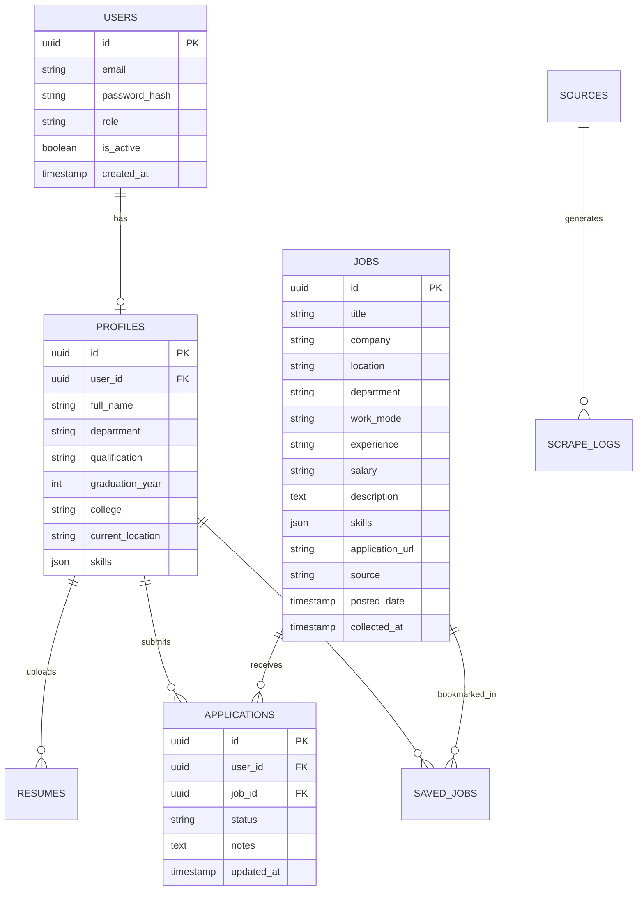

# Product Requirements Document (PRD)

## Project: Pathfinder – AI-Powered Campus Career & Job Recommendation Platform
**Institution:** K. S. Rangasamy College of Technology (Autonomous), Tiruchengode  
**Version:** 2.0  
**Status:** Approved / Active Production  
**Document Owner:** Project Engineering & Placement Cell Team  
**Last Updated:** October 2026  

---

## 1. Executive Summary

### 1.1 Problem Statement
Higher education engineering and management students often encounter severe friction when transitioning from campus to professional careers:
1. **Scattered Opportunities:** Job openings are dispersed across dozens of disparate recruitment platforms (LinkedIn, Internshala, Naukri, Instahyre, Arbeitnow), making manual tracking overwhelming.
2. **Opaque Job Matching:** Traditional job portals rely on rigid, shallow keyword searches that fail to understand semantic equivalence or real skill context between resumes and job descriptions.
3. **Branch-Specific Blindspots:** Core engineering students (Civil, Mechanical, Mechatronics, VLSI, EEE, ECE, Biotech, Food Tech, Textile) often struggle to find domain-aligned fresher roles amidst generic IT postings.
4. **Compliance & Trust Issues:** Automated tools frequently bypass security controls illegally or inject fake/mock listings, eroding credibility.

### 1.2 Solution Overview
**Pathfinder** is an enterprise-grade, institutional career discovery and AI job recommendation portal engineered specifically for **K.S. Rangasamy College of Technology (Autonomous)**. 

The platform merges:
* **Natural Language Processing & Embeddings:** Semantic matching using `spaCy`, `Sentence Transformers (all-MiniLM-L6-v2)`, and `Scikit-Learn TF-IDF`.
* **Ethical, Multi-Source Web Scraping:** Live data collection across verified portals (LinkedIn Guest Search, Internshala, Instahyre, Arbeitnow, Naukri XML Sitemaps) with strict anti-bot compliance.
* **Resume Parsing Engine:** Instant PDF/DOCX skill extraction, degree verification, and experience calculation.
* **Application Lifecycle Tracker:** Kanban-style management from `Saved` to `Offer`.
* **Campus Administrative Console:** Full visibility into recruitment runs, system health, and student user management.

---

## 2. Product Vision & Target Audience

### 2.1 Product Vision
To empower every student of K.S. Rangasamy College of Technology with an AI-driven, personalized placement co-pilot that surfaces 100% verified opportunities, diagnoses skill gaps, and streamlines career launches.

### 2.2 Target User Personas

| Persona | Role | Primary Goals & Jobs to be Done |
| :--- | :--- | :--- |
| **Final / Pre-Final Year Student** | Job Seeker | Upload resume, view tailored match scores (0-100%), explore domain-specific jobs across 15 college branches, apply directly to verified source listings. |
| **Placement Cell Officer / Admin** | Administrator | Monitor portal health, trigger real-time scraping runs, track student platform adoption, deactivate/manage accounts, view recruitment market analytics. |
| **System Auditor / Faculty Guide** | Reviewer | Verify algorithmic fairness, audit compliance logs, review ethical scraping boundaries and institutional affiliations. |

---

## 3. Supported Academic Disciplines (KSRCT Autonomous)

The platform provides dedicated classification, filtering, and scoring for all 15 academic departments of K.S. Rangasamy College of Technology:

1. **Computer Science & Engineering (B.E. CSE)**
2. **Information Technology (B.Tech. IT)**
3. **Artificial Intelligence & Data Science (B.Tech. AI & DS)**
4. **Artificial Intelligence & Machine Learning (B.E. AI & ML)**
5. **Electronics & Communication Engineering (B.E. ECE)**
6. **Electrical & Electronics Engineering (B.E. EEE)**
7. **VLSI Design & Technology (B.E. VLSI)**
8. **Mechanical Engineering (B.E. Mechanical)**
9. **Mechatronics Engineering (B.E. Mechatronics)**
10. **Civil Engineering (B.E. Civil)**
11. **Biotechnology (B.Tech. Biotech)**
12. **Food Technology (B.Tech. Food Tech)**
13. **Textile Technology (B.Tech. Textile)**
14. **Department of Management Studies (MBA)**
15. **Department of Computer Applications (MCA)**

---

## 4. System Architecture & Tech Stack

```
+-----------------------------------------------------------------------------------+
|                                 CLIENT LAYER                                      |
|    React 19 · TypeScript · Vite · Ant Design · Recharts · Lucide · Sonner         |
+-----------------------------------------+-----------------------------------------+
                                          |
                                 REST API | JSON (JWT Bearer)
                                          v
+-----------------------------------------------------------------------------------+
|                              BACKEND SERVICE LAYER                                |
|        FastAPI (Python 3.12) · Pydantic v2 · APScheduler · Multi-Threading        |
+-------------------+---------------------+--------------------+--------------------+
                    |                     |                    |
                    v                     v                    v
       +--------------------+  +--------------------+  +--------------------+
       |  AI / NLP ENGINE   |  | SCRAPING PIPELINE  |  | RESUME PARSER      |
       | · spaCy Core Web   |  | · Internshala      |  | · PyPDF (Text)     |
       | · Sentence-Xformers|  | · LinkedIn Guest   |  | · python-docx      |
       | · Scikit-Learn TF  |  | · Instahyre API    |  | · Regex Tokenizer  |
       | · Jaccard Overlap  |  | · Arbeitnow API    |  | · Skill Extractor  |
       |                    |  | · Naukri Sitemaps  |  |                    |
       +--------------------+  +--------------------+  +--------------------+
                                          |
                    +---------------------+---------------------+
                    v                                           v
       +----------------------------+              +----------------------------+
       |   MODE A: CLOUD SUPABASE   |              |   MODE B: LOCAL OFFLINE    |
       | · PostgreSQL with RLS      |              | · SQLite (app.db)          |
       | · Supabase Auth & JWT      |              | · Local JWT Tokens         |
       | · Bucket Storage (Resumes) |              | · File System Storage      |
       +----------------------------+              +----------------------------+
```

### 4.1 Technology Stack Details
* **Frontend:** React 19, TypeScript, Vite, Ant Design (AntD), Recharts, Tailwind CSS v4 utilities, Sonner toast notifications.
* **Backend:** Python 3.12, FastAPI, Pydantic v2, APScheduler (Background sync).
* **NLP & Matching:** spaCy (`en_core_web_sm`), Sentence-Transformers (`all-MiniLM-L6-v2`), Scikit-Learn (TF-IDF vectorizer fallback).
* **Scraping & Ingestion:** Requests, BeautifulSoup4, Gzip stream decompressor, ThreadPoolExecutor (concurrent harvesting).
* **Storage & Auth:** Dual-mode design supporting Cloud Supabase (PostgreSQL + RLS + S3 Storage) or zero-dependency Local Offline Mode (SQLite + App JWTs).

---

## 5. Functional Requirements (FR)

### FR-1: Institutional Authentication & Onboarding
* **Student Signup:**
  * Collects full name, email, password (min 8 characters), confirmed password, department (15 KSRCT options), qualification (B.Tech, B.E., MBA, MCA, etc.), and graduation year.
  * Institution default: Pre-locked to `K S Rangasamy College of Technology (Autonomous)`.
  * **Terms & Conditions Enforcement:** The *"Complete Sign Up"* button **must remain disabled by default** and only activate when the user explicitly checks the *"I agree to the Terms and Conditions"* checkbox. Unchecking instantly re-disables the button.
* **Role-Based Access Control:**
  * Roles: `student` and `admin`.
  * Student profiles access dashboard, job explorer, resume tools, and applications tracker.
  * Inactive/Deactivated accounts are rejected at both API and UI boundary with clear error messaging.

### FR-2: Real-Time Multi-Portal Web Scraper Service
* **Concurrent Execution:** Orchestrated by `ThreadPoolExecutor(max_workers=5)` to harvest live jobs simultaneously in under 15 seconds.
* **Source Integrations:**
  1. **Internshala:** Direct HTML DOM scraping across CSE, Civil, Mechanical, and Electrical categories with real salary CTC and experience requirements.
  2. **LinkedIn:** Public guest search query endpoint (`https://www.linkedin.com/jobs/search`) without requiring login or evading bot credentials. Exits cleanly on HTTP 429 rate limits.
  3. **Instahyre:** Ingestion via official public discovery JSON API (`/api/v1/job_search`) for startup and product company listings.
  4. **Arbeitnow:** Verified REST API (`/api/job-board-api`) for global remote engineering roles.
  5. **Naukri:** Decompresses official XML Sitemaps (`sitemap.xml.gz` declared in `robots.txt`). Parses structured parameters (title, company, city, experience, posting date) directly from URL slugs without bypassing reCAPTCHA gates.
  6. **Indeed & Foundit:** Transparently monitored and reported as *"Restricted by Anti-Bot"* rather than serving fabricated/fake mock jobs.
* **Deduplication:** Round-robin balancing by unique `application_url` and `(title, company)` tuple.
* **Branch Classification:** Automatic department inference (`infer_department`) mapping job descriptions into the 15 KSRCT academic branches.

### FR-3: AI-Powered Job Recommendation Engine
* Computes an explainable, multi-factor fit score for each student-job pair:

$$\text{Relevance Score} = 0.45 S_{\text{semantic}} + 0.25 S_{\text{skills}} + 0.10 S_{\text{qual}} + 0.10 S_{\text{exp}} + 0.05 S_{\text{loc}} + 0.05 S_{\text{type}}$$

| Component | Weight | Method |
| :--- | :---: | :--- |
| **Semantic Similarity** | **45%** | Cosine similarity between candidate profile text and job description using Sentence Transformers with TF-IDF fallback. |
| **Skill Overlap** | **25%** | Jaccard index between candidate extracted skills and job required skills; generates matching vs missing gap tags. |
| **Qualification Match** | **10%** | Degree level hierarchy check (B.Tech, B.E., M.Tech, MBA, MCA). |
| **Experience Compatibility** | **10%** | Compares candidate years of experience against job requirement threshold. |
| **Location Match** | **5%** | City match against candidate current or preferred location. |
| **Job Type Preference** | **5%** | On-site, Hybrid, Remote, or Internship preference matching. |

### FR-4: Resume Parser & Skill Extractor
* Supports `.pdf` and `.docx` document uploads.
* Employs boundary-safe regular expressions and spaCy tokenization against a dictionary of 100+ technical, mechanical, civil, and management competencies.
* Enables students to review, edit, and add customized skills before running AI recommendations.

### FR-5: Explore Jobs UI & Sticky Navigation
* **Dual-Column Layout:**
  * **Left Column (Filters):** Sticky sidebar containing Recruitment Source, Academic Department, Employment Type, Work Mode, and Experience Level filters.
  * **Behavior:** When scrolling down, the Filters section moves upward until reaching `76px` from the viewport top (12px below the navbar) and **locks in place**.
  * **Right Column (Real Openings):** Job cards grid and pagination scroll smoothly and independently while the filters remain pinned.
* **Department Quick Buttons:** One-click pill filters for `All` and all 15 KSRCT branch abbreviations (`CSE`, `IT`, `AI & DS`, `AI & ML`, `ECE`, `EEE`, `VLSI`, `Mechanical`, `Mechatronics`, `Civil`, `Biotech`, `Food Tech`, `Textile`, `MBA`, `MCA`).

### FR-6: Application Tracker & Saved Jobs
* 5-stage lifecycle pipeline: `Saved` $\rightarrow$ `Applied` $\rightarrow$ `Interview` $\rightarrow$ `Offer` $\rightarrow$ `Rejected`.
* Notes recording, status history timestamps, and direct application redirection.

### FR-7: Administrative Console
* **Overview Dashboard:** Live counters for registered users, active jobs, healthy sources, and collection runs with Recharts visualizations.
* **User Management:**
  * Displays registered student accounts with department, registration date, and status tags.
  * **Privacy & Isolation:** Administrator accounts are **completely excluded** from the user management table and count.
  * Department filter dropdown allowing placement officers to review students by discipline.
  * Safe account activation / deactivation controls with confirmation modals.
* **Source & Collection Management:** Real-time scraper status trigger, rate-limit health check, and historical audit logs.

---

## 6. Non-Functional Requirements (NFR)

### 6.1 Performance & Responsiveness
* Web scraper concurrent execution completes in $\le 15$ seconds for up to 100 live job records.
* Job recommendations compute in $\le 800\text{ms}$ using in-memory vector calculations.
* Frontend achieves sub-second initial paint with client-side TanStack Query caching (`staleTime: 60s`).

### 6.2 Security & Data Protection
* **Password Hashing:** Passwords encrypted using `bcrypt` (work factor 12).
* **JWT Authorization:** Stateless Bearer tokens with signature verification and role claims.
* **Row-Level Security (RLS):** Supabase database tables enforce isolated user access; students cannot query another student's resume or applications.
* **Sanitization:** All HTML descriptions sanitized to prevent Cross-Site Scripting (XSS).

### 6.3 Ethical & Legal Scraping Compliance
* Adheres to `robots.txt` specifications across all recruitment websites.
* Identifies itself via descriptive User-Agent headers (`CollegeJobResearch/1.0`).
* Never circumvents paid paywalls, private databases, or CAPTCHA challenges.
* Attributes all postings directly to their original employers with direct application URLs.

---

## 7. Data Models & Entity Schemas



---

## 8. Success Metrics & KPIs

1. **Placement Readiness Rate:** $> 80\%$ of active students upload an analyzed resume and receive matched scores $> 70\%$.
2. **Scraper Uptime & Freshness:** $> 95\%$ daily successful scraping runs providing at least 150+ live opportunities.
3. **Branch Inclusivity:** At least 25+ verified listings available for every one of the 15 KSRCT engineering & management disciplines.
4. **Time-to-Apply Reduction:** Reduces student search and filtering time by $> 65\%$ compared to external job boards.

---

## 9. Appendix: Institutional Identity
* **College:** K. S. Rangasamy College of Technology (Autonomous)
* **Approved by:** AICTE, New Delhi
* **Affiliated to:** Anna University, Chennai
* **Location:** KSR Kalvi Nagar, Tiruchengode – 637 215, Namakkal District, Tamil Nadu, India
